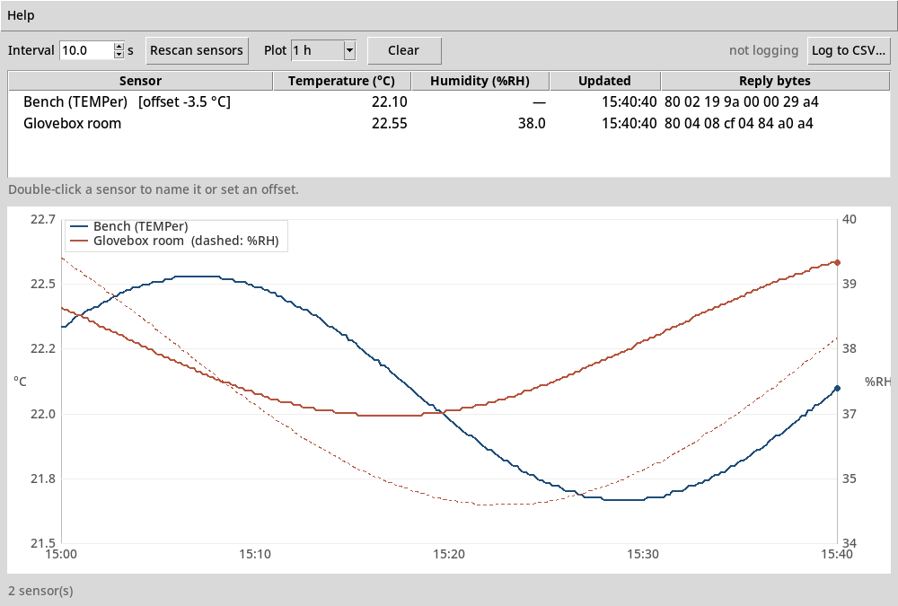

# USB Thermo Logger: user manual

USB Thermo Logger reads **TEMPer-compatible USB thermometers and hygrometers** (PCsensor and compatible),
shows their values live, plots them over time and logs them to a CSV file that opens in Excel, LibreOffice
or Origin. Several sensors can be read at once. It runs on Windows, macOS and Linux.

| Sensor (USB ID) | Reads |
|---|---|
| TEMPer (0c45:7401) | temperature |
| TEMPerHUM (0c45:7402) | temperature and relative humidity |
| TH1000 thermocouple interface (0c45:7403) | its internal (cold-junction) temperature only; thermocouple probe readings are not converted yet |

This manual covers version 0.2. It is also available in the program under **Help ▸ Manual** (or press F1).

## 1. Install

Download the file for your computer from <https://github.com/ohlincha/usb-thermo-logger/releases>.

| Computer | File | What to do |
|---|---|---|
| Windows | `ThermoLogger.exe` | Run it; no installation and no driver are needed. |
| macOS | `UsbThermoLogger-macOS.dmg` | Open it and drag *USB Thermo Logger* to Applications. The first time, right-click the app and choose *Open* (macOS 15: *System Settings ▸ Privacy & Security ▸ Open Anyway*); it is not notarised by Apple. |
| Linux (Debian/Ubuntu) | `usb-thermo-logger_<version>_all.deb` | In a terminal, in the download folder: `sudo apt install ./usb-thermo-logger_*_all.deb`. Start *USB Thermo Logger* from the applications menu, or run `thermo-logger`. |

On Linux the `.deb` also installs a *udev rule* so that no root is needed: the user logged in at the
computer can read the sensors, and over SSH members of the `plugdev` group. Unplug and replug the sensors
after installing. On other distributions, run `thermo_logger_gui.py` with Python 3 and Tk and install the
rule yourself:

```sh
sudo cp 70-usb-thermo-logger.rules /etc/udev/rules.d/ && sudo udevadm control --reload
```

## 2. Connect the sensors

1. Plug the sensors into USB ports, directly or through a hub. For the plain TEMPer, use a short USB
   extension cable so it is away from the warm computer (see section 5).
2. Start USB Thermo Logger. It finds all sensors by itself and reads them every 10 seconds.
3. If you plug in a sensor later, or unplug one, press **Rescan sensors**.

Sensors are told apart by the **USB port** they are in. Keep each sensor in the same port so that it keeps
its name and offset. On Linux the TH1000 is listed as a "Foot Switch" by the system; that is normal.

## 3. The main window



- **Interval**: seconds between readings (at least 1). Type a value and press Enter, or use the arrows.
- **Rescan sensors**: look for sensors again.
- **Plot**: how much time the plot shows (10 min, 1 h, 6 h, 24 h or all). **Clear** empties the plot; it
  does not affect a log file.
- **Log to CSV… / Stop logging** (right): see section 4. The label next to it shows the log file's name.
- **Sensor table**: one line per sensor with its name (and offset, if one is set), temperature in °C,
  humidity in %RH (TEMPerHUM only), the time of the last reading, and the sensor's raw reply bytes.
  *error* in the *Updated* column means the last reading failed; the status line at the bottom says why.
- **Plot area**: temperature as solid lines on the left axis, humidity as dashed lines on the right axis,
  one colour per sensor.

## 4. Log to a file

1. Press **Log to CSV…** and choose a folder and file name. The suggested name is
   `thermo_<date>_<time>.csv`.
2. From then on every reading of every sensor is added to the file, one line per sensor per reading, at the
   interval set above. Each line is written to disk at once.
3. Press **Stop logging** to close the file. Closing the program also closes it.

If you choose a file that already exists, the new readings are added at its end. The columns are:

```
time,sensor,temperature_C,humidity_pct,raw
2026-11-25T15:40:40,Glovebox room,22.55,38.04,80 04 08 cf 04 84 a0 a4
```

`time` is the local date and time; `sensor` is the sensor's name as shown in the table;
temperature and humidity include the offsets you have set; `humidity_pct` is empty for sensors without
humidity; `raw` is the sensor's reply.

## 5. Sensor names and offsets

**Double-click a sensor** in the table to open its settings:

- **Name**: e.g. *Bench* or *Glovebox room*. Used in the table, the plot legend and the log file.
- **Temperature offset (°C)** and, for the TEMPerHUM, **Humidity offset (%RH)**: added to every reading,
  e.g. `-3.5` to correct a sensor that reads 3.5 °C too high.
- **Match temperature to** (only with two or more sensors): choose a reference sensor and press
  **Set offset**. The offset is set so that this sensor reads the same as the reference right now. Let both
  sensors settle side by side for some minutes first.

Press **Save**. Settings are kept for each sensor model and USB port in `sensors.json` in
`%APPDATA%\usb-thermo-logger` (Windows), `~/Library/Application Support/usb-thermo-logger` (macOS) or
`~/.config/usb-thermo-logger` (Linux).

The plain TEMPer has its sensor inside the stick, next to its electronics, and warms itself by a few °C
(ours: about +3.5 °C after a few minutes in a USB hub). A short USB extension cable away from the computer
reduces this; an offset corrects the rest.

For unattended logging there is also a command-line program, `thermo-logger-cli` (Windows:
`thermo-logger-cli.exe`): `thermo-logger-cli list` lists the sensors, `thermo-logger-cli log -i 10 -o log.csv`
logs every 10 s until Ctrl-C. Run `thermo-logger-cli --help` for all options.

## 6. Troubleshooting

| Problem | What to do |
|---|---|
| *No sensors found* | Check the plug (try another port or the extension cable), then press **Rescan sensors**. |
| Linux: *Permission denied* | Install the udev rule (section 1; the `.deb` does this), then unplug and replug the sensors. |
| macOS: *IOHIDDeviceOpen failed* | Allow the app under *System Settings ▸ Privacy & Security ▸ Input Monitoring*, then restart it. |
| *error* in the table | The sensor was unplugged or did not answer. Plug it in again and press **Rescan sensors**. |
| A sensor lost its name or offset | It is in a different USB port. Move it back, or set the name and offset again. |
| Temperature too high (plain TEMPer) | Self-heating; see section 5. |
| Help ▸ Manual does nothing | Open this manual from <https://github.com/ohlincha/usb-thermo-logger/blob/main/docs/MANUAL.md>. |

Source code, issues and new versions: <https://github.com/ohlincha/usb-thermo-logger>.

*TEMPer is a trademark of PCsensor. This project is independent and not affiliated with or endorsed by
PCsensor.*
